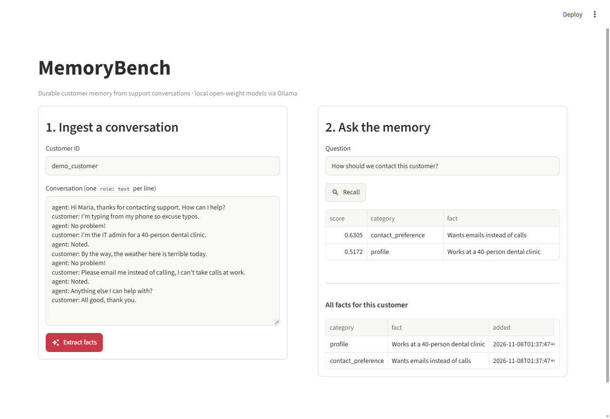
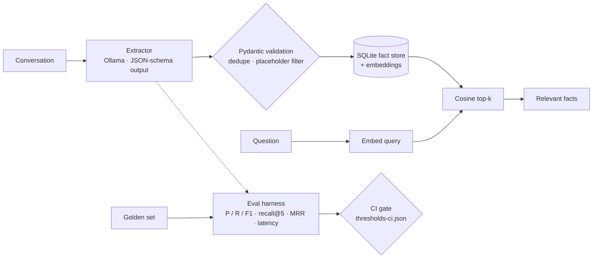

# MemoryBench

**Durable customer memory for support conversations, with an LLM eval regression gate.**

MemoryBench reads a customer-support conversation, extracts the facts worth remembering
(contact preference, plan, open issues, preferences, profile), stores them, and recalls the
right ones in the next conversation. A labelled golden set measures extraction and retrieval
quality, and GitHub Actions runs a real LLM evaluation on every push: **the build fails if quality drops**.

Everything runs on free, local, open-weight models through [Ollama](https://ollama.com). The client
speaks the OpenAI-compatible API, so swapping in another provider is a config change, not a code change.



## Results

Golden set: 60 synthetic support conversations (20 customers × 3), 100 labelled facts, 100 retrieval queries.
Measured on a laptop CPU (Intel, 8 cores, no GPU), temperature 0, embeddings `nomic-embed-text`.

| Model | Prompt | Precision | Recall | F1 | Retrieval recall@5 | MRR | Latency p50 / p95 |
|---|---|---|---|---|---|---|---|
| qwen2.5:3b | v1 | 0.30 | 0.65 | **0.41** | 0.63 | 0.46 | 18.9 s / 90.8 s |
| qwen2.5:3b | v2 | 0.84 | 0.60 | **0.70** | 0.63 | 0.52 | 10.2 s / 14.9 s |
| qwen2.5:1.5b (base) | v2 | 0.56 | 0.44 | **0.49** | 0.47 | 0.38 | 5.9 s / 13.1 s |
| **qwen2.5:1.5b + LoRA (fine-tuned)** | v2 | 0.92 | 0.93 | **0.93** | 0.93 | 0.75 | 6.4 s / 8.5 s |
| qwen2.5:1.5b * | v2 | 0.37 | 0.28 | **0.32** | 0.32 | 0.22 | 6.9 s / 22.8 s |

\* first 15 conversations only, run before the placeholder filter. Too weak to be a useful gate, so CI uses qwen2.5:3b. The v1 row was also measured before the placeholder filter was added.

## Fine-tuning: a 1.5B model beats the 3B one

A LoRA adapter (r=16) on `Qwen2.5-1.5B-Instruct`, trained with Unsloth on a **free Colab T4 GPU** in **3.7 minutes**
on 360 synthetic conversations ([`finetune/finetune_colab.ipynb`](finetune/finetune_colab.ipynb)), exported to GGUF q4_k_m
and served by Ollama ([`finetune/Modelfile`](finetune/Modelfile)).

- Training data is generated separately (`evals/gen_train.py`, seed 11, different customers) and **one phrasing template per
  category is held out**: 18 of the 100 eval facts use phrasings the model never saw.
- Same 1.5B model, same prompt: **F1 0.49 → 0.93**. It also beats the 3B prompt-only model (0.70) while being faster (p50 6.4 s vs 10.2 s).

Recall split by whether the phrasing appeared in training:

| Model | Seen phrasings (82 facts) | Unseen phrasings (18 facts) |
|---|---|---|
| qwen2.5:1.5b base | 0.45 | 0.39 |
| qwen2.5:3b, prompt v2 | 0.62 | 0.50 |
| qwen2.5:1.5b + LoRA | 1.00 | **0.61** |

Honest reading: perfect recall on seen phrasings is partly template memorisation (the data is synthetic); the unseen column
is the meaningful number, and the fine-tuned model still generalises better than both prompt-only baselines.
Lesson learned: the exported GGUF had no chat template; served raw, outputs were garbage until the Qwen chat template was
added to the Modelfile.

**What changed between v1 and v2.** Error analysis of the v1 run showed the model over-extracting
(218 facts for 100 gold): invented details ("Technology company, specializes in e-commerce"), one sentence
split into three facts, language preferences filed as contact preferences, and "Bye" stored as a fact.
Prompt v2 restricts extraction to explicit customer statements, one fact per sentence, sharper category
definitions and one few-shot example; a post-filter drops placeholder values such as "Not specified".

Raw outputs, including every predicted fact per conversation, are in [`evals/results/`](evals/results).

## How it works



- **Structured output**: the model decodes under the Pydantic JSON schema (`FactList`), then the result is validated again;
  invalid JSON is retried once and counted as a parse error.
- **Matching for evals**: a predicted fact counts as correct when the category matches and the value is semantically
  equivalent to the gold fact (embedding cosine ≥ 0.80, each gold fact matched at most once).
- **Retrieval is evaluated end to end**: queries run against the facts the extractor actually stored, not the gold facts.

## Eval gate in CI

`.github/workflows/ci.yml` runs on every push:
1. `unit-tests`: pytest with a fake LLM and fake embeddings (no model needed).
2. `eval-gate`: installs Ollama on the free GitHub runner, pulls `qwen2.5:3b` and `nomic-embed-text`, runs the eval on the
   first 15 conversations and fails if any metric is below [`evals/thresholds-ci.json`](evals/thresholds-ci.json).
   The eval JSON is uploaded as a build artifact.

## Run it

```bash
ollama pull qwen2.5:3b && ollama pull nomic-embed-text
python -m venv .venv && .venv/Scripts/pip install -r requirements.txt   # (bin/ on Linux/macOS)

pytest -q                                                    # unit tests
python -m evals.run_eval --model qwen2.5:3b --out evals/results/run.json
python -m evals.run_eval --model qwen2.5:3b --limit 15 --gate evals/thresholds-ci.json
uvicorn memorybench.api:app --reload                         # API on :8000
pip install streamlit && streamlit run demo/app.py           # demo UI
docker compose up                                            # API + Ollama
```

API:

| Method | Path | |
|---|---|---|
| POST | `/conversations` | extract and store facts from `{customer_id, turns:[{role,text}]}` |
| GET | `/customers/{id}/facts` | all stored facts |
| GET | `/customers/{id}/recall?q=...&k=5` | top-k facts for a question |

## Limitations

- The golden set is synthetic (template-generated, seed 7, see `evals/gen_golden.py`). It tests the pipeline and catches
  regressions; it does not measure performance on real customer data.
- Semantic matching at a 0.80 threshold can accept a near-miss or reject a correct paraphrase.
- The store is SQLite + NumPy cosine search, sized for a demo; the `FactStore` interface is what a Postgres + pgvector
  backend would implement.
- Prompt-only small models miss many facts (3B recall 0.60); the fine-tuned 1.5B fixes most of it on this distribution, but its training data shares templates with the eval set (see the seen/unseen split).

## Stack

Python 3.11 · Unsloth / LoRA (PEFT) · Hugging Face · FastAPI · Pydantic · OpenAI-compatible client · Ollama (qwen2.5) · nomic-embed-text · NumPy · SQLite ·
pytest · GitHub Actions · Docker Compose · Streamlit
